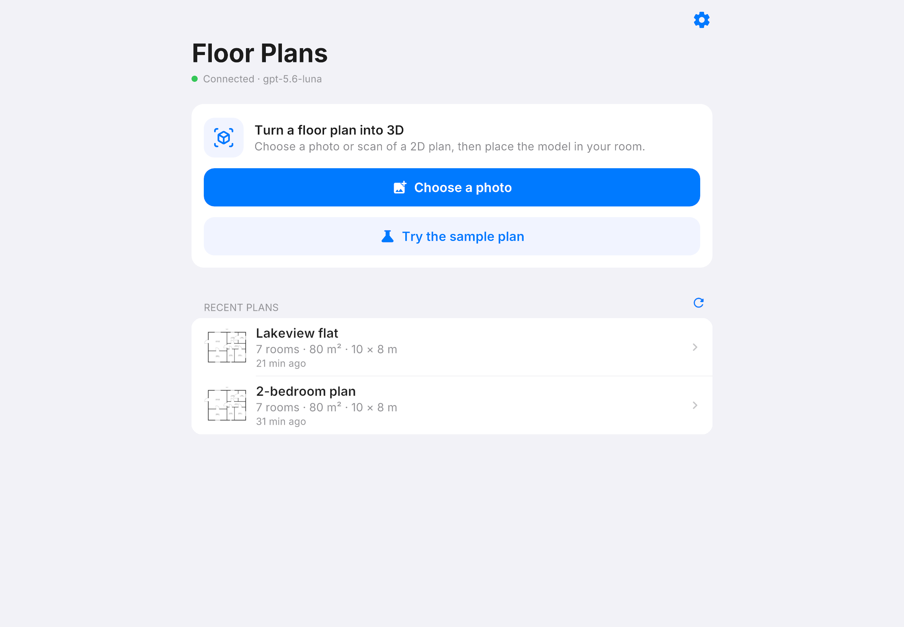
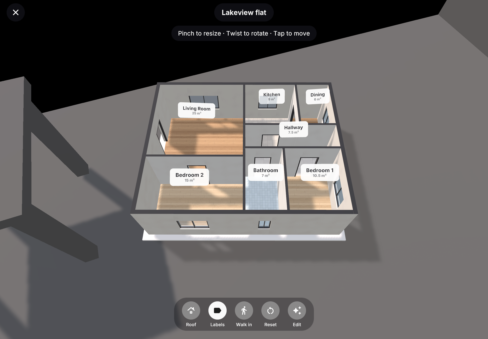
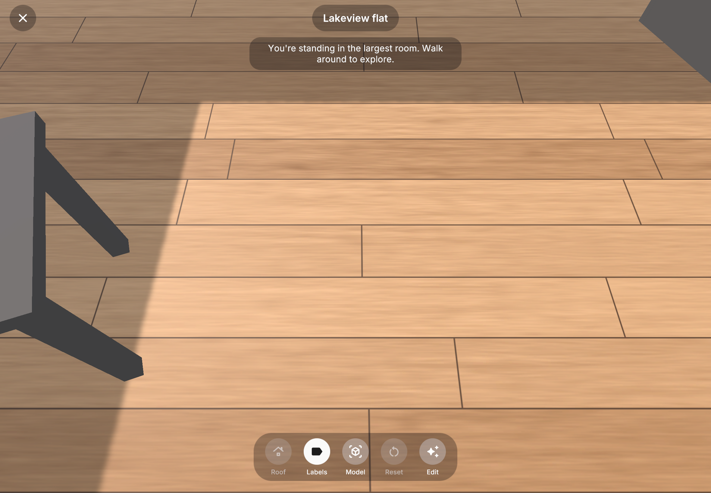

# AR Floor Plan Visualizer

Turn a photo of a 2D floor plan into an interactive 3D model, then place it in the real world with AR.
An OpenAI vision model reads the plan. Python code cleans it up and builds the geometry. A Unity app on
iPhone or iPad shows the result as a tabletop model or a life-size walkthrough, including multi-storey
buildings with stairs.

<p>
  
  
  
</p>

## How it fits together

```
iPhone / iPad (Unity + ARKit)  ──HTTP, same Wi-Fi──▶  Backend on the laptop (FastAPI, port 8000)
                                                          │
                                                          ▼
                                                     OpenAI API
```

| Folder | Contents |
|---|---|
| [backend/](backend/) | FastAPI service: plan parsing, geometry, saved plans, eval harness |
| [unity-project/floor-plan-viz/](unity-project/floor-plan-viz/) | Unity 6 AR app (URP, AR Foundation, ARKit) |
| [docs/](docs/) | Plans, progress notes, Mac build guide, screenshots |

## Prerequisites

**Backend (any OS)**
- [uv](https://docs.astral.sh/uv/) 0.11 or later. It installs Python 3.12 for you.
- An OpenAI API key with access to the configured model.

**Unity app (Windows or Mac)**
- Unity Hub with Unity **6000.6.3f1**, plus the **iOS Build Support** module.
- Git, because Unity fetches the NativeGallery package from GitHub.
- Optional: the Unity CLI, to drive the Editor from a terminal.

**Running on a device**
- A Mac with **Xcode** to sign and install the exported project.
- An Apple ID. A free Personal Team works, but builds expire after 7 days.
- An ARKit-capable iPhone or iPad on iOS 15 or later, with Developer Mode turned on.

## 1. Backend

```bash
cd backend
uv sync
cp .env.example .env          # then fill in OPENAI_API_KEY
uv run uvicorn floorplan.main:app --host 0.0.0.0 --port 8000
```

Visit `http://localhost:8000/health` to check that the server is up. To let a phone reach it, allow
port 8000 through the laptop's firewall and look up the laptop's LAN IP (`ipconfig` on Windows,
`ipconfig getifaddr en0` on a Mac).

### Environment file: `backend/.env`

| Variable | Required | Default | Purpose |
|---|---|---|---|
| `OPENAI_API_KEY` | yes | — | OpenAI key |
| `OPENAI_MODEL` | no | `gpt-6.2-sol` | Vision model used for parsing and edits |
| `OPENAI_REASONING_EFFORT` | no | model default | `low`, `medium` or `high` |
| `DATA_DIR` | no | `data` | Where saved plans are stored |
| `MAX_PHOTOS` | no | `8` | Maximum photos per building job (one per floor) |
| `MAX_UPLOAD_BYTES` | no | `15728640` | Upload size limit |

Each variable maps to a field in [config.py](backend/src/floorplan/config.py). `.env` is gitignored.

### Useful commands

```bash
uv run try-plan samples/two_bedroom.png          # parse with the model, writes out/<name>.json and .png
uv run try-plan samples/two_bedroom.spec.json    # geometry only, no API call
uv run pytest                                    # tests
uv run ruff check . && uv run ruff format --check .
uv run eval --help                               # accuracy eval against hand-traced plans (makes API calls)
```

[backend/README.md](backend/README.md) covers the endpoints and the pipeline.

## 2. Unity app

1. In Unity Hub, choose **Add → Add project from disk** and select `unity-project/floor-plan-viz`. Open
   it with 6000.6.3f1. The first import takes a few minutes.
2. Open `Assets/FloorPlanViz/Scenes/Main.unity`.
3. If the scenes or generated assets are missing or out of date, run **Floor Plan Viz → Rebuild Scenes**.

### Try it in the Editor

Play mode uses **XR Simulation**, so no device is needed.

1. Start the backend.
2. Press Play. Open server settings on the home screen and enter `http://127.0.0.1:8000`.
3. Tap **Try sample plan**, or pick an image to parse, then tap **View in AR**. Place the model and toggle
   the roof, labels and walkthrough.

The `PlanDebug` scene renders a plan without AR, which is handy for checking geometry.

### Editor menu: **Floor Plan Viz**

| Item | What it does |
|---|---|
| Configure iOS | Player settings, ARKit and Simulation loaders, AR background |
| Build Assets | Generates textures, materials, prefabs and API settings |
| Configure Rendering | URP quality and shadow settings |
| Rebuild Scenes | Runs the items above, then regenerates `Main` and `PlanDebug` |
| Build iOS Xcode Project | Exports the Xcode project to `Builds/iOS` |

The scenes are generated from code. Change the UI in `Scripts/Editor/Ui/*Builder.cs` and `SceneBuilder.cs`,
not in the scene files.

## 3. Run on iPhone or iPad

1. In Unity, run **Floor Plan Viz → Build iOS Xcode Project**. This writes
   `unity-project/floor-plan-viz/Builds/iOS`.
2. Copy that folder to the Mac. Then fix its permissions, sign it, build it and install it by following
   [docs/MAC_BUILD.md](docs/MAC_BUILD.md). In short:

   ```bash
   xattr -dr com.apple.quarantine . && chmod -R +x Il2CppOutputProject/IL2CPP
   find . -name "*.sh" -exec chmod +x {} +
   xcodebuild -project Unity-iPhone.xcodeproj -scheme Unity-iPhone -configuration Release \
     -destination 'generic/platform=iOS' -derivedDataPath build -allowProvisioningUpdates \
     DEVELOPMENT_TEAM=<TEAM_ID> CODE_SIGN_STYLE=Automatic build
   ```

3. Open the app, then enter `http://<laptop-lan-ip>:8000` in server settings. The phone and the laptop must
   be on the same Wi-Fi network.

Don't accept Xcode's "Update to recommended settings" prompt. The next Unity export overwrites those
settings anyway.

## Documentation

- [docs/PLAN.md](docs/PLAN.md): v1 design, data contract and milestones
- [docs/PLAN_V2.md](docs/PLAN_V2.md): flexible plans and whole buildings
- [docs/PLAN_FURNITURE.md](docs/PLAN_FURNITURE.md): furniture plan
- [docs/progress.md](docs/progress.md): status, decisions, eval results and known issues
- [docs/MAC_BUILD.md](docs/MAC_BUILD.md): signing and installing on the Mac
